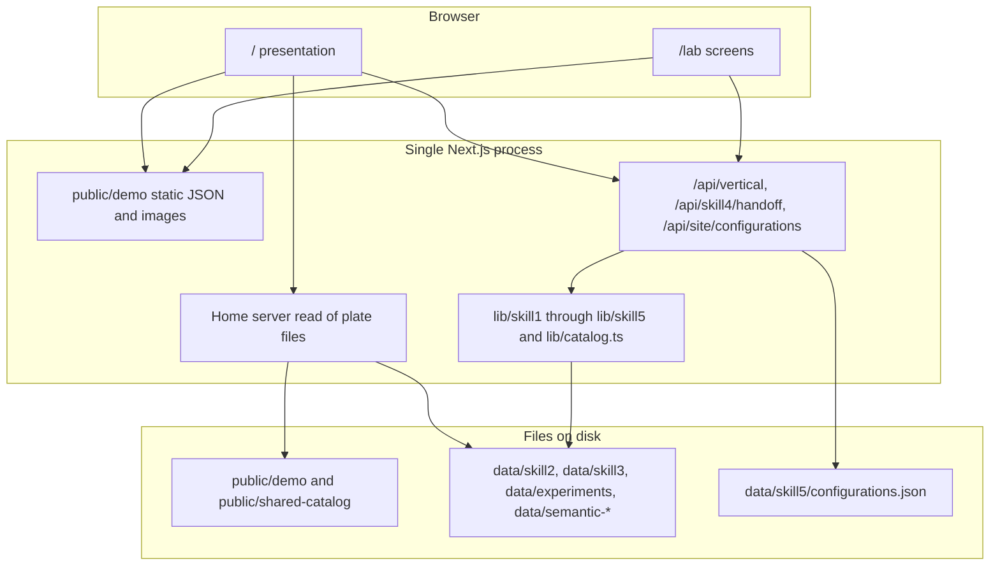

# Deployment readiness audit

**Date:** 26 October 2026  
**Presentation:** 27 October 2026  
**Scope:** The inspection below was read-only. No deployment configuration, Vercel project, or Supabase project was changed when this report was later added to `main`.

## Current status — 26 October 2026, after consolidation

This report was written earlier the same day against `public-demo` at `9e6244b`, before that work was on `main`. The sections below are that inspection record. Where they disagree with this section, use this section.

| Item | Current state |
| --- | --- |
| Authoritative branch | `main`. The website and the Lab are one Next.js application on that branch. |
| Presentation frame | 7407 × 2160. The older 1920 × 560 frame was not restored. |
| Integration already on `main` | `85a8de0` contains Skill 5, the home site section, `public/demo/skill3/vertical-void/351-workflow.json`, and Inserted Horizontal Plate N47. |
| Website behavior | `7a3eaac` keeps the later camera behavior: the generation frame opens its zoom, the criteria panel grows from the criteria frame, the Skill 2 route returns at pace 1.25, and each visit has its own clock. The criteria back control uses the shared `.wf-opt-back` rule. |
| Verification on that integration | `npx tsc --noEmit --pretty false --incremental false` exited 0. `npx next build` exited 0 (Next.js 16.3.5, compiled in 26.9s, TypeScript finished in 9.1s). Lab routes including `/lab/physarum`, `/lab/evolution/pareto-catalog`, `/lab/vertical`, `/lab/hybrid`, and `/lab/site` are in the route table. |
| Still relevant for deployment | Do not split the website and Lab into two Vercel apps, and do not add Supabase for the presentation. Vercel’s filesystem is read-only, so Skill 5 `PUT`, lobby-cache writes, and `?generate=1` are unsafe there. `/api/semantic-catalog/...` is still not implemented. Tracked `data/semantic-catalogs` and `data/semantic-runs` are still large. `public/demo` is still a static payload. `maxDuration = 300` may exceed a Hobby limit. `generate=1` is unauthenticated. The production build reproduced the dynamic-tracing warnings in `lib/skill2/semantic/run-root.ts` and `lib/skill2/semantic/z0-snapshot.ts`. |
| Superseded by `main` | The `tsc` errors in section 7. The statements that Skill 5, the home site, `351-workflow.json`, and N47 are absent from every commit. Blockers 1–3. The deploy-target table’s description of `origin/main` as `e4a3b12`. |

No `vercel.json`, environment file, or application runtime setting was edited for this status update.

**Historical verdict, written before consolidation:** Do not split the website and the Lab into two Vercel applications for the presentation, and do not create a Supabase project for it. At the time of the inspection the working tree could not be deployed as it was: `tsc --noEmit` failed, and Skill 5 plus the home site section were not in any commit. That typecheck failure and those missing commits are the superseded items in the table above. The least disruptive path remains one Next.js application.

---

## How to read this report

**Verified** means a command or file inspection in this working tree produced the result.  
**Inferred** means the code path supports the conclusion, but the production behavior was not executed.  
**Not run:** `next build`, a browser pass, `git fetch`, and any call to GitHub or Vercel. Remote tips below are the local `origin/*` refs already stored in this clone. `origin/main` is commit `e4a3b12` (26 October 2026, 13:17 -0400). `origin/public-demo` is commit `8daffa1`.

---

## 1. Repository architecture

| Item | Verified finding |
| --- | --- |
| Framework | Next.js `16.3.5`, React `19.2.8`, TypeScript 5, Tailwind 4. App Router. |
| Package | `living-morphologies`, private. Repository field points at `https://github.com/mariaecalonso/livingmorphologies.git`. |
| Scripts | `dev` and `start` use `next` on `0.0.0.0:43141`. `build` is `next build`. Vercel does not use that port. |
| Config | `next.config.ts` only. No `vercel.json`, no `middleware.ts`, no `.vercel/` directory, no `.env` file. |
| Typecheck | `tsconfig.json` is `strict`, includes `**/*.ts` and `**/*.tsx`, excludes `node_modules` and `tmp`. `typescript.ignoreBuildErrors` is not set. |
| Dependencies (runtime) | `next`, `react`, `react-dom`, `three`, `@react-three/fiber`, `manifold-3d`. |
| Dependencies (dev / scripts) | Tailwind, ESLint, `sharp`, `gifenc`, `puppeteer-core`. Puppeteer and sharp are not required to render the site. |

### Entry points and routes

The site shell is `app/layout.tsx` (local Neuropol, Google Orbitron and Rajdhani, plus a Typekit stylesheet). `/` is `app/page.tsx`, which server-renders plate metadata and passes it to the client `HomePage`.

| Route | Role |
| --- | --- |
| `/` | Presentation website. |
| `/lab` | Redirects to `/lab/physarum`. |
| `/lab/physarum`, `/runs`, `/catalog` | Skill 1 instrument. |
| `/lab/evolution`, `/pareto`, `/pareto-catalog` | Skill 2. The live catalog pages import `public/demo/skill2/*.json`. |
| `/lab/vertical`, `/catalogue`, `/final`, `/experiments/all-futures` | Skill 3. The process and catalogue pages are `force-dynamic` and read the filesystem. |
| `/lab/hybrid`, `/catalog` | Skill 4. |
| `/lab/site`, `/configurations` | Skill 5. **Working tree only.** Not in `HEAD` or `origin/main`. |
| `/hybrid`, `/filament` | Redirects into `/lab/...`. |
| `/api/vertical/[[...path]]` | Skill 3 continuations, solidified meshes, carved-mass dataset. `nodejs`, `force-dynamic`, `maxDuration = 300`. |
| `/api/skill4/handoff` | One Skill 3 mesh, registered for Skill 4. |
| `/api/site/configurations` | Skill 5 save file. **Working tree only.** `GET` and `PUT`. |

There is no `/api/semantic-catalog/...` route. `components/vertical-process.tsx` and `lib/skill2/published-catalog-view.ts` still request that path.

### Git status

Verified on 26 October 2026:

- Branch: `public-demo` at `9e6244b` (“Show the committed Pareto catalog as the only Skill 2 catalog.”, 26 October 2026, 11:50 -0400).
- Tracking: `origin/public-demo` at `8daffa1`. This branch is **23 commits ahead** of that remote ref. Those 23 commits are not on the fetched `public-demo` tip.
- Against fetched `origin/main`: merge-base `7737a13`. **6 commits are on `main` and not in `HEAD`. 2 commits are on `HEAD` and not in `main`.**
- Working tree: **58** porcelain entries (modified, deleted, and untracked). Skill 5, the home site section, the site API, precedent images, growth GIFs, and `public/demo/skill3/vertical-void/351-workflow.json` are among the untracked paths.
- Local pack size: **5.60 GiB** (`git count-objects -vH`, 15,290 packed objects). About **10,150** tracked paths.
- No file at or above 40 MB was found under `data/`, `public/`, or `exports/`. The size problem is the number of files and the pack, not a single blob over GitHub’s 100 MB file limit.

Commits on `origin/main` that are not in local `HEAD`:

- `e4a3b12` Merge origin/main into the Skill 3 process checkpoint.
- `27f7be7` Share current Skill 3 process diagrams.
- `12b156e` Pareto catalog commit on main (different hash from local `9e6244b`).
- `e095cd4` Skill 3 process canvas and hybrid catalogue.
- `6f5203a` Skill 4 handoff points at Inserted Horizontal Plate **N47**.
- `1218c29` Close the three Review Skill 3 meshes into one solid body each.

Commits on local `HEAD` that are not in `origin/main`:

- `9e6244b` Pareto catalog as the only Skill 2 catalog.
- `30f0c70` Lab canvases fit the presentation frame.

`git diff --shortstat origin/main HEAD`: 934 files, +1,396 / −11,894 lines.  
`git diff --shortstat origin/public-demo HEAD`: 1,449 files, +36,150 / −6,026 lines.

Fetched `origin/public-demo` does **not** contain `app/api/vertical/[[...path]]/route.ts` or `data/skill3/final-selection.json`. Fetched `origin/main` at `e4a3b12` did. Neither of those fetched tips contained `app/lab/site/page.tsx`. That site page is on `main` from `85a8de0`.

**Assumption:** the fetched `origin/*` tips still match GitHub. This audit did not `git fetch`.

---

## 2. Website and Lab relationship

They are one Next.js application. The website does not call a separate Lab service. Shared behavior is TypeScript imported from `lib/` and JSON imported or read from `data/` and `public/`.

### What the presentation actually loads

Verified import and `fetch` paths:

| Surface | Source | Needs the Lab API? |
| --- | --- | --- |
| Home hero and most workflow frames | Components plus `public/demo/home/presentation.json` | No |
| Physarum workflow frames | `fetch /demo/skill1/<id>/entries.json` | No |
| Optimization frames | `fetch /demo/skill2/catalog.json` and `picks.json` | No |
| Results plates | `loadHomeResultPlates()` in `lib/home-result-plates.ts` reads `public/shared-catalog`, `public/demo/skill2/previews`, and `public/demo/skill2/propagation` | No, if those files are deployed and the page can read them at build or request time |
| Vertical workflow board | `components/home-vertical-workflow.tsx`, mounted only for the active Skill 3 stage | **Yes.** It loads `/demo/skill3/vertical-void/351-workflow.json` (untracked) and then `/api/vertical/solidified` for the mesh list and mesh URLs. The handoff list is the static import of `data/skill3/final-selection.json`. |
| Site section on `/` | `components/home-site.tsx` imports `data/skill5/herald-site.json` and `SiteViewport` (`three`) | No API for the base model. Aerial asset is `public/skill5/herald-aerial-2024.jpg` (untracked). |
| Skill 2 lab pages | Static imports of `public/demo/skill2/process.json`, `catalog.json`, `picks.json` | No |
| Skill 1 lab | `LivingInstrument` runs the simulation in the browser from `lib/skill1/engine` and `lib/catalog.ts` | No |
| Skill 3 lab | Server `readProcessSource` and `/api/vertical` | Yes, and it reads Z0 snapshots from disk |
| Skill 4 lab | Browser state, `localStorage` catalog, `fetch /api/skill4/handoff` | Yes, for real meshes |
| Skill 5 lab | Browser placement and manifold clipping; `GET`/`PUT /api/site/configurations` | Yes, for saved configurations |

`public/demo/skill2/picks.json` and `data/skill2/pareto-catalog/selections.json` list the same 15 archetype candidate ids (0 mismatches). That check did not compare scores or images.

### Two Vercel apps

**Feasible later, not tomorrow, and not without a shared data plan.**

- There is no shared package. Splitting the repo duplicates `lib/` or requires a monorepo extraction that does not exist.
- Research outputs are files in this repository, not a database. Two deployments of the same commit each carry a copy of the committed files. They stay consistent only until one side writes.
- Browser calls use same-origin paths (`/api/...`, `/demo/...`). The three route handlers set no CORS headers. A website origin calling a Lab origin would fail in the browser until a proxy or CORS policy exists.
- Writable state cannot be shared through Vercel’s serverless filesystem. Skill 5 configurations, the Skill 4 catalog (`localStorage`), and the Skill 3 lobby bundle cache would diverge immediately.

---

## 3. Computational requirements by skill

### Skill 1 — architectural criteria to Physarum

| | |
| --- | --- |
| Browser | **Verified.** `/lab/physarum` renders `LivingInstrument`, which imports `createSimulation` and `stepMany` from `lib/skill1/engine`. Ratings come from `lib/catalog.ts`. Runs stay in the page. |
| Server | Not required for the instrument. |
| Local / persistent | `npm run verify:skill1`, `search:void`, and `search:contained` are Node scripts. They write stills under paths ignored by Git (`public/void-search`, `public/contained-search`). |
| Vercel | Interactive generation can run in the visitor’s browser. The 50-seed searches cannot: they are batch CPU work that writes the local disk. |
| Presentation copy | `public/demo/skill1` (tracked, 52.9 MB, 1,475 files) and `public/shared-catalog` (tracked, 993.2 MB, 1,475 files). |

### Skill 2 — 2D generation, evaluation, selection

| | |
| --- | --- |
| Browser | Pareto charts and the catalog UI. The lab pages are fed by committed demo JSON, not by a live search. |
| Server | The vertical page’s server render imports `loadVerifiedZ0` (`lib/skill2/semantic/z0-snapshot.ts`) through `lib/skill3/process-source.ts`. That is a file read, not a new search. |
| Local / persistent | The search itself is `scripts/evolve.ts`, `scripts/semantic-lobby.ts`, and `scripts/lobby-semantic-v1.ts`. They write `data/semantic-runs`, previews, and Z0 `.bin`/`.json` pairs, then delete non-catalog snapshots. `lib/skill2/semantic/run-root.ts` also looks in `%USERPROFILE%/Desktop/living-morphologies-set-aside/`. A full generation is multi-minute or multi-hour Node work with a durable directory. It does not fit a Vercel invocation. |
| Vercel | Ship the already exported `public/demo/skill2` catalog. Do not run calibration, lobby publish, or evolution on Vercel. |
| Missing route | `/api/semantic-catalog/<archetype>/<id>` is still referenced. The Optimization pages avoid it by importing demo JSON. The Vertical process page still fetches it, so those images 404. **Verified** by route inventory. |

### Skill 3 — vertical propagation

| | |
| --- | --- |
| Browser | Catalogue and process views fetch `/api/vertical` and `/api/vertical/solidified`, then draw meshes with Three.js. |
| Server | **Verified.** `lib/server-routes/vertical.ts` reconstructs continuations from a verified Z0 (`loadVerifiedContinuations`) and reads solidified meshes from `data/experiments/carved-mass-solidified`. `?generate=1` on the carved-mass dataset calls `generateCarvedMassArchetype`, which writes the experimental dataset. |
| Disk writes | A published Lobby bundle is cached under `data/skill3/published-lobby/` (gitignored, 39.3 MB locally). `writeLobbyBundle` uses `writeFileSync` and is not inside the route’s `catch`. |
| Vercel | `runtime = "nodejs"`, `maxDuration = 300`. When `process.env.VERCEL === "1"`, the dataset response sets `mesh: null` so the function does not return full meshes. Reconstruction still needs the Z0 files inside the function bundle, and the solidified route still `readFileSync`s meshes. See the tracing excludes in section 5. **Inferred:** a cache miss that tries to write `published-lobby` throws on Vercel’s read-only filesystem and becomes a 500. |
| Do not run on Vercel | `?generate=1`, provisional replay of a missing snapshot, or any first-time continuation build that depends on a multi-hundred-megabyte data directory the function trace excludes. |

### Skill 4 — hybrid connection

| | |
| --- | --- |
| Browser | Assembly, face choice, hybrid-field generation, and manifold booleans. `lib/skill4/boolean-adapter.ts` dynamically imports `manifold-3d/manifold`. The saved assembly catalog is `localStorage` (`lib/skill4/catalog-store.ts`), empty on the server. |
| Server | `GET /api/skill4/handoff?archetype=` loads one solidified mesh, registers it into the Skill 4 cell, and returns JSON with a one-day `s-maxage` cache header. |
| Vercel | The browser work is fine. The handoff route has the same filesystem problem as Skill 3: the mesh files are what `outputFileTracingExcludes` removes. Synthetic test modules are built in the browser and do not need the route. |

### Skill 5 — site integration

| | |
| --- | --- |
| Browser | `SiteViewport` (React Three Fiber) and placement math in `lib/skill5`. Polygon clipping dynamically imports `manifold-3d` from `components/site/site-geometry.ts`. Module meshes are loaded with `fetch /api/vertical/solidified`. |
| Server | `app/api/site/configurations/route.ts` reads and writes `data/skill5/configurations.json`. `PUT` creates the directory and writes the file. There is no auth. |
| Persistence | At inspection time, the whole of `lib/skill5`, `data/skill5` (0.3 MB), `public/skill5` (1.0 MB aerial), `app/lab/site`, and `app/api/site` was **untracked**. Those paths are on `main` as of `85a8de0`. |
| Vercel | The herald site model can ship as a bundled JSON import. Saved configurations cannot stay on the serverless disk. `PUT` will throw. **Inferred** from the write path plus Vercel’s read-only filesystem. Not executed against Vercel. |

---

## 4. Data and storage

Sizes are the working tree on 26 October 2026, excluding `node_modules`, `.git`, and `.next`. The tree without those directories is about **3.66 GB**. `data/` is **2.11 GB** (4,017 files). `public/` is **1.42 GB** (5,858 files).

| Location | Size | Files | Git | Role |
| --- | --- | --- | --- | --- |
| `public/shared-catalog/` | 993.2 MB | 1,475 | Tracked. Also excluded from function traces. | Skill 1 plate PNGs for the home Results strip. |
| `public/demo/` | 387.7 MB | 4,328 tracked | Tracked. Not in the trace exclude list. | Presentation and lab snapshots. Skill 2 is 295.4 MB of this. |
| `public/demo/skill3/` | 39.4 MB | 2 tracked plus 1 untracked workflow JSON | The new `351-workflow.json` is untracked. | Vertical story on the home workflow board. |
| `public/assets/skill0/` | 12.8 MB | 29 on disk, **4 tracked** | New precedent images and growth GIFs are untracked. Two SVGs are deleted in the working tree. | Home precedent imagery. |
| `public/skill5/herald-aerial-2024.jpg` | 1.0 MB | 1 | Untracked | Site aerial. |
| `public/references/` | 22.8 MB | 15 | Not counted separately; excluded from traces. | Reference images. |
| `data/experiments/carved-mass-solidified/` | 543.4 MB | part of 723 | Tracked, with **uncommitted edits** and untracked N47 | Authoritative solidified meshes for Skills 3–5. |
| `data/experiments/carved-mass/` | 145.2 MB | part of 376 | Tracked | Experimental module library. |
| `data/skill2/pareto-catalog/` | 679.4 MB | 1,362 | Tracked | Kept Skill 2 catalog, including `selections.json`. |
| `data/semantic-catalogs/` | 560.1 MB | 1,351 | **Tracked even though `.gitignore` lists it** | Older published catalog tree. Ignore does not remove tracked files. |
| `data/semantic-runs/` | 95.6 MB | 33 | **Tracked even though `.gitignore` lists it** | Z0 snapshots and run metadata used by Skill 3. |
| `data/filament-cache/` | 39.0 MB | 144 | Ignored, 0 tracked | Rebuildable preview cache. |
| `data/skill3/published-lobby/` | 39.3 MB | — | Ignored | Runtime cache. Not in a Git deploy. |
| `data/skill3/final-selection.json` | small | 1 | Tracked, **modified** | The 15-module handoff the home vertical board imports. |
| `data/skill5/` | 0.3 MB | 3 | Untracked | Herald site, workplace brief, configurations. |
| `exports/` | 117.3 MB | 20 | Tracked | Not inspected file by file. Ships if the branch is deployed. |
| `tmp/` | 5.1 MB | 11 tracked | Tracked, though `tsconfig` excludes the folder and Next excludes it from traces. | Local audit leftovers. |
| `calibration/`, `public/void-search/`, `public/contained-search/` | — | — | Ignored | Script output. |

### Authoritative copies, and what production would show

| Dataset | Authority in this working tree | Production risk |
| --- | --- | --- |
| Criteria and descriptors | `lib/catalog.ts` | Low, if the deployed commit is this tree. |
| Skill 2 chosen candidates | `data/skill2/pareto-catalog/selections.json`, mirrored by `public/demo/skill2/picks.json` | Low for ids. Image freshness depends on `npm run export:public-demo` having been run after the last catalog change. That export was not re-run here. |
| Skill 3 handoff | Working-tree `data/skill3/final-selection.json` matches the continuation ids on fetched `origin/main` (including Inserted Horizontal Plate **N47**, status Validated). Local `HEAD` still has the previous ids (N47 is N02 and several statuses are `Review`). | Deploying local `HEAD` shows the old handoff. Deploying `main` shows the new ids but not the uncommitted website. The N47 mesh **is on `origin/main` and on disk, and is not in local `HEAD`.** |
| Solidified geometry | `data/experiments/carved-mass-solidified/` | Working tree also has uncommitted edits to N02 meshes for inserted-horizontal-plate, linear-edge-gallery, and void-edge, plus their metrics. Those bytes are not the `HEAD` versions. |
| Skill 5 site | `data/skill5/herald-site.json` and `workplace-brief.json` | Absent from the commits inspected that day. Present on `main` from `85a8de0`. |
| Skill 5 configurations | `data/skill5/configurations.json` | Local file only. `GET` returns an empty document when the file is missing. `PUT` cannot persist on Vercel. |
| Skill 4 assemblies | Browser `localStorage` | Per browser. Not in Git and not shared across deploys. |
| Skill 2 / Skill 3 UI selections | `sessionStorage` / `localStorage` keys in `lib/skill2/published-selection.ts` and `lib/skill3/selection.ts` | A fresh visitor does not see another machine’s picks. The committed selections are a different channel. |

`.gitignore` lists `data/semantic-runs/`, `data/semantic-catalogs/`, `data/filament-cache/`, and `data/skill3/published-lobby/`. The first two are still tracked (1,351 and 33 files). A production deploy of this branch **includes** them. The ignore rules only stop new untracked files.

---

## 5. Deployment readiness

### Next.js and Vercel configuration

`next.config.ts` sets `agentRules: false`, allows localhost dev origins, hides the dev indicator, and excludes these from **every** serverless trace (`outputFileTracingExcludes["*"]`):

- `data/**/*.png`
- `data/**`
- `public/shared-catalog/**`
- `public/assets/**`
- `public/references/**`
- `tmp/**`
- `config/**`

**Verified intent from history, not from a new build:** commits `48439e8`, `99395ba`, `5f0ad6f`, and `a128f73` describe keeping a Vercel Hobby deploy under the function-count and payload limits, including one catch-all API and stripped meshes. There is no linked Vercel project in this clone, so the live plan and the last successful deployment were not inspected.

**Inferred conflict:** the excludes keep the function small, and they also remove the files `readFileSync` needs at request time (`data/experiments`, Z0 snapshots, `data/skill5`). Files that are **imported** as modules, such as `selections.json` in `lib/server-routes/vertical.ts` and `final-selection.json` in the home vertical component, are bundled by the compiler and do not depend on the trace. Files opened by a computed path do.

`public/` files requested by the browser (`/demo/...`, `/shared-catalog/...`) are static assets. They do not need to be inside the function. They still have to fit in the deployment. `public/` alone is 1.42 GB.

`maxDuration = 300` is above the Hobby cap this repository previously coded around. Whether the current Vercel account allows 300 seconds was **not** verified. If the account is still Hobby, this setting is either clamped or rejected at deploy.

### Environment variable names

No values were read. No `.env` file is present. Names referenced in code:

| Name | Where | Needed to boot the site? |
| --- | --- | --- |
| `VERCEL` | `lib/server-routes/vertical.ts` | Set by Vercel. Gates mesh stripping. |
| `NODE_ENV` | `components/dev-overlay-pass-through.tsx` | Set by Next. |
| `USERPROFILE`, `HOME` | `lib/skill2/semantic/run-root.ts` and local scripts | No for the website. Points Skill 2 at another machine’s Desktop copy when that folder exists. |
| `LM_PORT` | `lib/skill2/open-filament.ts` | Scripts only. Default 43141. |
| `LM_PUBLISH_WORKTREE` | `scripts/lobby-semantic-v1.ts` | Scripts only. Default is a hard-coded Desktop path. |
| `EXPORT_BASE` | `scripts/export-presentation-pdfs.mjs` | Scripts only. |
| `FFMPEG` | `scripts/record-lab-demo.mjs` | Scripts only. |

No `NEXT_PUBLIC_*` variables. No Supabase, Blob, or KV client.

### Filesystem assumptions that break on Vercel

| Path | Operation | Result on a read-only function |
| --- | --- | --- |
| `data/skill5/configurations.json` | `PUT` writes the file | **Inferred 500.** |
| `data/skill3/published-lobby/*.json` | written on first Lobby bundle | **Inferred 500** on the write, before the JSON response. |
| `data/experiments/carved-mass/` | `?generate=1` writes a dataset | **Inferred 500**, and the work is too heavy for a public route. |
| `data/skill2/pareto-catalog/selections.json` | `writeSavedPick` | Not exposed as an API. Script/local only. |
| `%USERPROFILE%/Desktop/living-morphologies-set-aside` | extra Z0 root | Does not exist on Vercel. Reads fall back to `data/semantic-runs`. |

### Other production notes

- No authentication middleware. A public URL exposes the Lab, `PUT /api/site/configurations`, and `GET /api/vertical/experiments/carved-mass/dataset?generate=1`.
- `app/layout.tsx` loads `https://use.typekit.net/rau7owf.css`. The presentation font depends on that host.
- `npm start` binds port 43141. Vercel’s runtime ignores that script and serves the Next build itself.
- Dev-only `allowedDevOrigins` does not affect production.

---

## 6. Performance

| Issue | Evidence | Effect |
| --- | --- | --- |
| Home bundle includes the site viewer | `HomePage` statically imports `HomeSite`, which statically imports `SiteViewport` (`three` and `@react-three/fiber`). The canvas mounts only when the section intersects, but the modules are in the home graph. | Large first-party JavaScript on `/`. A dynamic import around `SiteViewport` would keep Three.js off the initial download. |
| Home bundle includes the vertical mesh viewer | `home-workflow-prototype.tsx` statically imports `VerticalWorkflowLayer` from `home-vertical-workflow.tsx`, which imports `CatalogueField`. Only the active stage mounts, which does not by itself code-split a static import. | Skill 3 mesh code is parsed with the home page. |
| Skill 3 stage pulls API meshes | The vertical board `fetch`es the solidified catalogue and one mesh URL when that stage is opened. | Opening Vertical Propagation on the home page depends on the API and on large JSON bodies. The summary JSON in `public/demo/skill3` is the light path; the mesh fetch is the heavy one. |
| Dynamic file tracing | `z0-snapshot.ts` joins `data/semantic-runs/<archetype>/z0` and `data/skill2/pareto-catalog/<archetype>/propagation` from runtime ids, and `run-root.ts` probes a Desktop path. The vertical page and `/api/vertical` import this module. | **Inferred** source of the broad trace warning. Next’s file tracer cannot see a closed file set, so it considers a very large directory. The existing excludes are the mitigation, with the runtime cost in section 5. This audit did **not** run `next build`, so the warning text was not reproduced. The dev log had no matching lines. |
| Traced static weight | `public/demo` is 388 MB and is not excluded. `public/shared-catalog` is 993 MB and is excluded from functions, but it is still a static deployment payload if the commit contains it. | Clone, build, and upload time dominate. The home page only needs two plates per archetype from the shared catalog (`PHYSARUM_PLATES = 30`). |
| No `next/dynamic` | Repository search found no `next/dynamic` or `dynamic()` calls. | Route-level code splitting is only what Next does automatically. |
| Precomputation already exists | `public/demo/skill2`, propagation slice JSON, and solidified meshes are the precomputed presentation. | Keep using those. Do not recompute Z0 or carved mass during a request. |
| Caching | Skill 4 handoff sets `s-maxage=86400`. Vertical and site routes are `force-dynamic` and uncached. Skill 5 configurations change when saved, so they should not be cached. Solidified meshes are immutable per id and could be cached. | Cache headers on solidified `GET`s would cut repeat load during a talk. |

---

## 7. Production errors

**Superseded.** On `main` after `7a3eaac`, the same `tsc` command exited 0 and `next build` completed. The errors below describe the `public-demo` working tree at the time of the inspection.

`npx tsc --noEmit --pretty false --incremental false` exited **2**. `next build` was not run. Because `ignoreBuildErrors` is unset, a production build is **inferred to fail** on the same project errors. Script-only `gifenc` errors are included because `tsconfig.json` includes `scripts/`.

### `components/hybrid/hybrid-state.tsx`

**Verified.** Five errors, all from `useState(freshBoard(...))` inferring a board whose connection `orientation` is only `"ready" | "unresolved"`, then later updates returning the wider `TileConnection[]`.

| Line | Code | What fails |
| --- | --- | --- |
| 152 | TS2345 | `setBoard` updater after modules load |
| 172 | TS2345 | `chooseArchetype` updater |
| 235 | TS2345 | `generateHybridFieldForConnection` updater |
| 256 | TS2345 | `poseTiles` updater |
| 335 | TS2322 | `restoreAssembly` assigns `TileConnection[]` to that narrowed state |

This blocks the Hybrid lab and the whole `next build`. It is a type mismatch, not a logic change that has to be redesigned.

### `lib/skill2/semantic/z0-snapshot.ts`

**No TypeScript error** in that file. The operational issue is dynamic `node:fs` access:

- `loadVerifiedZ0` (around line 214) builds `data/semantic-runs/<archetypeId>/z0/<candidateId>.{json,bin}`, then falls back to `data/skill2/pareto-catalog/<archetypeId>/propagation/`.
- The module imports `SEMANTIC_RUN_ROOT` from `run-root.ts`, whose `semanticRunRoots()` calls `existsSync` on a path under `USERPROFILE` or `HOME`.
- Importers on the server graph include `lib/skill3/semantic-handoff.ts`, `lib/skill3/process-source.ts`, `app/lab/vertical/page.tsx`, and `app/api/vertical/[[...path]]/route.ts`.

**Inferred:** that is the broad file-tracing warning. **Not reproduced** in this audit.

### Other TypeScript errors that also block the build

| File | Error | Presentation impact |
| --- | --- | --- |
| `components/home-site.tsx:46` | TS2741, `showAerial` is required by `SiteViewport` and not passed | Home site section |
| `components/home-workflow-stage-layer.tsx:59` | TS2353, `"--share"` is not a known React `style` key | Workflow evaluation tracks |
| `components/site/site-workspace.tsx:5` and `:6` | TS2300, duplicate `CatalogEntry` import | Skill 5 lab |
| `components/hybrid/hybrid-assembly.tsx:344` | TS18047, attachment depths possibly `null` | Skill 4 |
| `components/hybrid/hybrid-assembly.tsx:516` and `:534` | TS2304, `IsoMesh` is not imported | Skill 4 |
| `components/hybrid/som-inspect.tsx:392` and `:406` | TS2322, `number` is not the expected opacity literal union | Skill 4 |
| `lib/skill4/hybrid-deformation.ts:91` | TS2345, `number \| undefined` | Skill 4 library |
| `lib/skill4/verify-boolean-execution.ts:162` | TS2367 | Verify script, still in the `tsc` project |
| `lib/skill5/mock-assemblies.ts:37` | TS2322, `rotationQuarter: number` is not `0 \| 1 \| 2 \| 3` | Skill 5 |
| `scripts/capture-physarum-growth.ts:7`, `scripts/capture-void-growth.ts:7` | TS7016, `gifenc` has no types | Scripts. They fail `tsc` because of `include`. |

### Runtime blockers that `tsc` does not report

| Severity | Item |
| --- | --- |
| High | `/api/semantic-catalog/...` is fetched and not implemented. |
| High | Skill 3 and Skill 4 APIs read `data/**` that the trace exclude removes. **Inferred** empty or 500 responses in production. |
| High | Lobby bundle write and Skill 5 `PUT` need a writable project directory. |
| High | At inspection time `public/demo/skill3/vertical-void/351-workflow.json` was untracked, so the home vertical summary would 404 on a deploy of those commits. The file is on `main` as of `15d631f`. |
| Medium | Unauthenticated `generate=1`. |

---

## 8. Deployment strategy

### Comparison

| | One Vercel app | Website and Lab as two Vercel apps | This machine for the talk |
| --- | --- | --- | --- |
| Matches the code | Yes. Routes already split `/` and `/lab`. | No. Shared `lib/` and same-origin fetches assume one origin. | Yes. |
| Data | One copy of the committed files. Writes still do not persist. | Two copies. Writes diverge. CORS is missing. Skill 5 would have to be committed into both or extracted. | The 3.5 GB working tree is already here, including uncommitted Skill 5 and N47. |
| Tomorrow | Blocked by TypeScript and by the 5.60 GiB pack plus 1.4 GB of `public/` until a host is confirmed. | More moving parts than the time allows. | No clone, no function trace, no read-only filesystem. |
| After the presentation | Remains the right shape until outputs move to object storage. | Reasonable only after a shared package and a URL or storage layer for meshes and configurations. | Not a public archive. |

### Supabase

A dedicated Supabase project is **not** necessary for 27 October.

Nothing in the repository talks to Supabase. The presentation’s research outputs are JSON, PNG, and WebP files. Putting them in Postgres would be a migration, not a deploy. Supabase (or Vercel Blob) becomes useful only when Skill 5 configurations, or the Skill 4 catalog, must persist across serverless instances and be shared between visitors. That is a product decision for after the presentation. For a single speaker machine, the local JSON file and `localStorage` are enough.

### Recommended architecture

Keep **one** Next.js application.

- The public presentation reads committed and exported files: `public/demo/**`, the small set of Results plates, `lib/catalog.ts`, and the bundled herald site JSON.
- The Lab stays on `/lab` in the same deployment when it is shown.
- Skill 1 interaction stays in the browser.
- Skill 2 search, Skill 3 generation (`?generate=1`), and Z0 writes stay on a workstation. Production only reads precomputed meshes and demo JSON.
- Do not add a second Vercel project or a database before the talk.

### What “deploy GitHub” would actually publish

| Deploy target | What the room would see |
| --- | --- |
| Fetched `origin/public-demo` (`8daffa1`) | An October 8 line. No vertical API, no final-selection file, no Skill 5, none of the 23 local commits. |
| Fetched `origin/main` at inspection (`e4a3b12`) | Skill 3 handoff, including N47, and the vertical API. At that moment it was missing Skill 5, the home site, and the vertical workflow JSON. Those are on `main` from `85a8de0` onward. |
| Local `HEAD` (`9e6244b`) | Presentation-frame lab commits and older Skill 3 handoff (N02 / `Review` where the working tree now says N47 / `Validated`). No Skill 5. |
| This working tree | The presentation as it runs locally, including Skill 5 and the updated handoff. **Not deployable until `tsc` is clean and the untracked presentation files are in the commit that gets built.** |

---

## Blockers, ranked

Blockers 1–3 described the pre-consolidation checkout. They are superseded by the current-status table. Blockers 4–10 still describe the deployment constraints.

1. **Build is red.** `tsc --noEmit` fails on the home site, the workflow layer, Skill 4, and Skill 5. A Vercel build has no `ignoreBuildErrors` escape hatch in config.
2. **The presentation is not in Git.** Skill 5, the site API, the home site section, the aerial, new Skill 0 media, and the Skill 3 workflow JSON are untracked. Fifty-eight porcelain entries sit on top of a branch that is already 23 commits ahead of GitHub `public-demo`.
3. **The branches disagree about the Skill 3 handoff.** Local `HEAD` is the previous 15 continuations. `origin/main` and the working tree name N47 and the newer continuation ids. N47’s mesh is on `main` and on disk, not in `HEAD`. Uncommitted edits also touch other solidified meshes.
4. **Payload.** Local Git packs are 5.60 GiB. `public/` is 1.42 GB and `data/` is 2.11 GB, and most of that is tracked. A Vercel Git deploy has to clone and upload that. This was not attempted.
5. **Serverless filesystem versus the APIs.** Trace excludes drop `data/**`. Vertical, Skill 4 handoff, and Skill 5 configuration routes read or write those paths. Lobby cache writes and configuration `PUT`s need a writable disk.
6. **`maxDuration = 300` and an open `generate=1` route.** Prior commits targeted Vercel Hobby. The account limit was not re-checked. The generate route is unauthenticated.
7. **`/api/semantic-catalog` is missing** while the vertical process UI still requests it.
8. **Broad tracing from `z0-snapshot.ts`.** Inferred, not reproduced. The exclude list is already the project’s mitigation, and it causes blocker 5.
9. **Home JavaScript weight.** Three.js and the vertical catalogue are statically imported from the home page. This does not block a deploy. It does slow the first load on a classroom network.
10. **Typekit.** The layout depends on `use.typekit.net`. If that request fails, Neuropol, Orbitron, and Rajdhani are still declared locally or through `next/font`.

---

## Ordered plan

Do these in order. Steps 1–3 are the only ones that matter before the presentation. None of them were done in this audit.

1. **Decide the machine.** If the talk can use this computer, run the existing dev server or a local `next start` after step 2. Skip Vercel until after 27 October. This avoids the pack size, the read-only disk, and the unpublished branch.
2. **Make `tsc --noEmit` pass** without `ignoreBuildErrors`. The home site `showAerial` prop, the workflow `"--share"` style, the duplicate `CatalogEntry` import, the Hybrid state narrowing, the missing `IsoMesh` import, and `mock-assemblies` rotation are the presentation failures. `gifenc` can be fixed with a small declaration or by excluding `scripts/` from the app typecheck. Do not change simulation parameters or catalog numbers as part of that fix.
3. **If a public URL is required:** commit the working tree that the talk actually uses, including `data/skill5`, `public/skill5`, `public/demo/skill3/vertical-void/351-workflow.json`, the new Skill 0 assets, and the updated `final-selection.json` plus the N47 mesh. Build from that commit, not from GitHub `main` and not from GitHub `public-demo`. Use **one** Vercel project. Confirm the plan allows the deployment size and the 300-second function, or remove `maxDuration` and do not call continuation rebuilds live.
4. **Keep generation off the public route.** Do not invite the room to hit `?generate=1`. Prefer a static mesh already in `data/experiments/carved-mass-solidified`. Turn on Vercel Deployment Protection if the URL must not be world-writable (`PUT` configurations).
5. **Treat saves as local.** For tomorrow, either commit a seed `configurations.json` and ignore failed `PUT`s, or demo Skill 5 on the local server where the write succeeds. Do not stand up Supabase tonight.
6. **After the presentation, if production hosting is still the goal:**
   - Stop tracking `data/semantic-catalogs` and `data/semantic-runs` only after a replacement path is deployed. Today Skill 3 still reads them. A blind `git rm --cached` would break the Lab.
   - Move solidified meshes and demo media to object storage or a CDN, and point the existing URLs at that store. Then the function trace no longer needs `data/**`.
   - Add cache headers on immutable solidified `GET`s.
   - Lazy-load `SiteViewport` and `VerticalWorkflowLayer` from the home page.
   - Add persistence (Supabase or Blob) only for Skill 5 configurations and, if needed, the Skill 4 catalog.
   - Split the website and the Lab only after those URLs exist and CORS or a shared origin is explicit.

---

## Verification that was not completed

| Check | Why it was skipped |
| --- | --- |
| `next build` | Writes `.next` and is the expensive trace the audit was asked not to disturb beyond inspection. The warning in `z0-snapshot.ts` was therefore not captured live. |
| Browser walkthrough | No code was changed. Behavior above is from source, not from a clicked-through session. |
| `git fetch` / GitHub API / Vercel API | Remote state was not contacted. Findings use local `origin/main` and `origin/public-demo`. |
| Vercel plan limits and deployment size quota | No `.vercel` project link and no account access. Hobby tension is from commit messages plus `maxDuration = 300`, not from a live project setting. |
| Byte-level diff of every modified solidified mesh | `final-selection.json` was diffed. The other modified mesh files were identified in Git status and not unpacked. |
| Whether `npm run export:public-demo` output is newer than every Pareto image | Candidate ids match. File timestamps and image bytes were not compared. |
