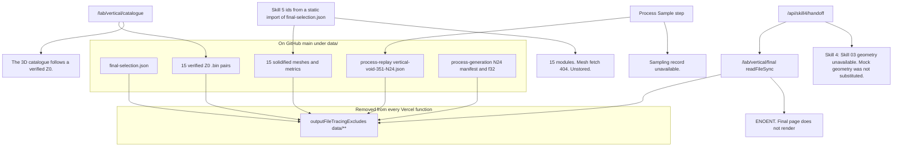

# Vercel runtime diagnostic

**Date:** 27 October 2026  
**Commit inspected:** GitHub `main` at `9c2c182` (27 October 2026, 00:23 -0400, “Draw the Step 05 surface as white particles…”).  
**Local checkout:** `29c1614`, one commit behind that tip. `git diff HEAD origin/main` changes only `components/process-generation-view.tsx`. Working tree clean. Every data path below is the same blob on both commits.

This pass did not change code, data, or deployment settings, and it did not run a new production build. The ENOENT below is the error already reported from the live Vercel functions.

---

## Confirmed root cause

`data/skill3/final-selection.json` is on GitHub `main`. It is not gitignored, not generated at runtime, and not stored under another path. Vercel still throws:

`ENOENT: /var/task/data/skill3/final-selection.json`

because the routes that fail open it with `readFileSync` at request time, and `next.config.ts` removes **all** of `data/**` from every serverless file trace:

```7:16:next.config.ts
  outputFileTracingExcludes: {
    "*": [
      "data/**/*.png",
      "public/shared-catalog/**",
      "public/assets/**",
      "public/references/**",
      "tmp/**",
      "data/**",
      "config/**",
    ],
  },
```

`/var/task` is the deployed function root. A file excluded from the trace is not copied there. `existsSync` / `readFileSync` then report ENOENT even though `git cat-file` on `origin/main` succeeds.

The same exclude is why the website can work while the Lab cannot. Pages that **import** the JSON (`components/home-vertical-workflow.tsx`, `lib/skill5/catalog.ts`, `components/final-morphology-catalogue.tsx`) receive it inside the compiled module. Pages and routes that **read the file from disk** do not.

| Caller | How it reads the handoff | On Vercel |
| --- | --- | --- |
| `/lab/vertical/final` | `readFinalSelection()` → `readFileSync(process.cwd() + "/data/skill3/final-selection.json")` | **Confirmed ENOENT.** The page throws before render. |
| `/api/skill4/handoff` | `loadSkill3HandoffRecord` calls `readFinalSelection()` before it looks for a mesh | **Confirmed ENOENT.** |
| Skill 5 module list | `import selection from "@/data/skill3/final-selection.json"` | Bundled. The 15 ids can render. Meshes are a later fetch. |
| Home vertical board | static import of the same JSON | Bundled. Does not need the file on disk. |

`readFinalSelection` is in `lib/skill3/final-selection.ts` lines 26–32. There is no fallback and no static import on that path.

---

## What is actually on GitHub `main`

Verified with `git cat-file -e origin/main:<path>` and local sizes. Local disk matches this commit for these paths.

| Path | Git | Size | Needed by |
| --- | --- | --- | --- |
| `data/skill3/final-selection.json` | Tracked | Small. 15 selections, contract `skill3-final-selection-v1` | Final page, Skill 4 handoff, Skill 5 ids |
| `data/experiments/carved-mass-solidified/<archetype>-<candidate>-<continuation>.json` | Tracked for all 15 selected ids | **25.7 MB** total. Largest single mesh **2.67 MB** (`void-field` N19) | Skill 4 handoff, Skill 5 `loadArchetypeMesh`, solidified catalogue |
| Matching `metrics/*.json` | Tracked | Small next to the meshes | Catalogue status |
| `data/semantic-runs/<archetype>/z0/<candidate>.bin` and the pareto `propagation/` pair | Tracked for all 15 selected candidates | Present. `.gitignore` lists `data/semantic-runs/`, but these files were committed earlier, so Git still ships them | `loadVerifiedZ0`. Required before the catalogue will leave the “verified Z0” gate |
| `data/skill2/pareto-catalog/selections.json` | Tracked | Small | `loadSavedPicks` / catalogue gate |
| `data/skill3/process-replay/vertical-void-351-N24.json` | Tracked | **1.36 MB** | Sample step on the Skill 3 process page |
| `data/experiments/process-generation/vertical-void-351/N24/` | Tracked. 1 manifest + 15 `.f32` fields | Manifest 3 KB. Each `.f32` is 72³ × 4 bytes ≈ 1.4 MB | Generation replay for Vertical Void N24 only |
| `data/skill3/published-lobby/` | **Ignored.** Not a substitute | Local cache only | Written by `/api/vertical` on a cache miss. Not on Vercel, and the function filesystem is read-only |
| `public/demo/skill1/stepped-amphitheater/` | Tracked | 100 entries, **2.6 MB** of WebP, each image under 43 KB | Skill 1 catalog |
| `public/demo/skill2/` | Tracked. Not in the trace exclude list | Served as static files and, on the lab pages, imported | Skill 2. This is why Optimization still works |

The 15 handoff rows on this commit are the current selection, including Inserted Horizontal Plate **N47**. They are not an older Review set.

---

## Skill 3 → Skill 4 → Skill 5



### Dependency chain

1. **Authoritative list.** `data/skill3/final-selection.json` names 15 modules: archetype, Skill 2 candidate, continuation id, `moduleId`, status. Geometry directory recorded in the file: `data/experiments/carved-mass-solidified`.
2. **Verified Z0.** `loadVerifiedZ0` (`lib/skill2/semantic/z0-snapshot.ts`) reads `data/semantic-runs/<archetype>/z0/<candidate>.bin` and `.json`, then the pareto `propagation/` pair. The catalogue page will not open a candidate unless `catalogHandoff` returns `"verified"`. That call is `readFileSync`. With `data/**` excluded, every candidate stays `"pending"`, `firstVerifiedSavedPick()` returns null, and `components/vertical-selection.tsx` shows: “The 3D catalogue follows a verified Z0.”
3. **Sampling record.** The Sample step fetches `/api/vertical/process-replay`. The handler only reads `data/skill3/process-replay/<archetype>-<candidate>-<continuation>.json`. For the live process that file is `vertical-void-351-N24.json`. It is in Git. It is under `data/**`, so the function does not see it and the UI shows “Sampling record unavailable.” The route does not rebuild the replay on a miss. Rebuilding would call `openVerifiedSemanticHandoff`, which also needs the Z0 files.
4. **Generation fields.** `/api/vertical/process-generation` and `.../field` read only `data/experiments/process-generation/vertical-void-351/N24/`. Those files are in Git and excluded the same way. Other continuations are rejected in code even when the files exist: the route requires archetype `vertical-void`, candidate `351`, continuation `N24`.
5. **Final page.** Disk read of the handoff. ENOENT. No mesh is requested.
6. **Skill 4.** Handoff route dies on that same read. `adaptModule` then keeps the tile unavailable. The sentence “Mock geometry was not substituted.” is the explicit branch in `lib/skill4/adapt.ts` when a Skill 3 record has no usable mesh. It is not a second missing asset.
7. **Skill 5.** Ids come from the bundled JSON, so the updated interface can list 15 modules. `loadArchetypeMesh` fetches `/api/vertical/solidified`, which `readFileSync`s the mesh under `data/experiments/carved-mass-solidified/`. Those files are excluded, the route 404s, and the UI reports the meshes unstored.

### Downstream versus independent

| Observation | Cause |
| --- | --- |
| Final page fails | **Direct.** ENOENT on `final-selection.json`. |
| Skill 4 “geometry unavailable / mock not substituted” | **Downstream of that ENOENT**, then of the mesh read. Fixing only the JSON still leaves meshes out of the function. |
| Skill 4 saved assemblies | **Independent.** `lib/skill4/catalog-store.ts` is `localStorage`. A new browser, or another visitor, has an empty catalog. Nothing in Git or on Vercel stores those assemblies. Saving still works in the browser that saved them. |
| Skill 4 interface weight | **Independent of the missing file.** The page statically imports boolean execution, the assembly model, and the module graph. Missing meshes do not make that bundle smaller. |
| Skill 3 catalogue “verified Z0” | **Same packaging rule, different file.** Z0 bins are in Git and excluded. Not caused by the final-selection ENOENT. |
| Skill 3 catalogue slowness | **Hypothesis.** The page is `force-dynamic` and imports the Z0 reader, semantic run loader, and Skill 1 archetypes before it can return the gate message. Cold start of that function, plus the client waiting on `/api/vertical` and `/api/vertical/solidified`, matches “extremely slow.” This pass did not time the live function. |
| Sampling record unavailable | **Same packaging rule.** Replay JSON is in Git and excluded. |
| Skill 5 missing meshes | **Same packaging rule on the mesh files.** The id list itself is not blocked by the ENOENT. |
| Skill 1 lag | **Independent.** Browser main thread. See below. |
| Skill 1 amphitheater entry | **Not a missing Git file.** See below. |
| Skill 2 | **Independent and currently healthy.** Static `public/demo/skill2` JSON. Leave it on that path. |

---

## Skill 1 amphitheater catalog

**Confirmed about the data**

- `public/demo/skill1/stepped-amphitheater/entries.json` has 100 entries.
- All 100 WebP files are beside it. Total image weight 2.6 MB. Largest image 43 KB.
- Every entry has `slime.foodPoints` and attractors with numeric `x` and `y`.
- A replay of `runAttractorsFor` for all 100 stored seeds does not throw. `attractorsFromSteppedAmphitheater` returns an empty list; the saved recipe is what the detail sheet renders.

**Confirmed about the cost**

- Catalog view still builds 80 run variants on the main thread whenever the archetype is selected (`variants` in `components/run-grid.tsx`), including a Stepped Amphitheater plan per cell.
- Runs mode calls `stepMany` for all remaining iterations of a cell inside one frame (`DISPLAY_ITERATIONS` is 600). Eighty cells run one after another. That is the heavy Runs page.
- The Physarum board steps in batches of about `maxIterations / 180` and calls `setState` every batch (`components/living-instrument.tsx`). Generation stays on the main thread, so the page lags while it is correct.

**Not confirmed**

This pass did not reproduce a page-level crash by opening a committed amphitheater entry. `CatalogDetail` only opens a client overlay. It does not navigate, and it does not read `data/`. A client exception is possible for an IndexedDB copy of an entry whose attractor `x`/`y` are missing, because `attractorRows` calls `toFixed`. The committed 100 entries are not that case.

Three other catalogs do have entries with no `slime` object: compressed-sequential (100), flat-deep-plan (66), topographic-ground-field (35). The detail sheet skips the slime list when `slime` is absent, so those are not the amphitheater failure either.

---

## Browser versus server cost

| Work | Where it runs | Why it is expensive |
| --- | --- | --- |
| Skill 1 Generate | Browser | Full Physarum step on the UI thread, with analysis published every batch. |
| Skill 1 Runs | Browser | 80 simulations, 600 iterations each, one cell fully stepped inside a single frame, then a snapshot saved to IndexedDB. |
| Skill 1 Catalog | Browser | Fetch `entries.json`, decode up to 100 images, and still allocate 80 variants. Images themselves are small. |
| Skill 2 catalog | Browser + static JSON | Already the cheap path. No server read of `data/`. |
| Skill 3 catalogue and process | Serverless function | `force-dynamic`. Reads Z0, replay JSON, and meshes through `fs`. Those reads are ENOENT or 404 today. If the large mesh directory were traced back in, catalogue listing would `readdir` and header-read every solidified file on the request. |
| Skill 3 solidified response | Server, then browser | One selected mesh is 0.85–2.67 MB of JSON. Under the usual 4.5 MB response cap individually. Decoding and drawing happen in the browser after the fetch. |
| Skill 4 | Browser | Assembly, face solving, and boolean execution load with the page. Manifold is a dynamic import inside the boolean adapter, but the page still parses the assembly module up front. Geometry fetch never succeeds, so the canvas has nothing to draw. |
| Skill 5 | Browser | Three.js viewport. Fifteen sequential mesh fetches, each 404, then no geometry. |
| File trace | Build | `z0-snapshot.ts` joins runtime archetype ids and also checks a Desktop path from `run-root.ts`. That is the broad trace. `data/**` was excluded to keep the functions deployable. The exclusion is why the Lab files disappear. |

`/api/semantic-catalog/...` is still requested by the older vertical process component and still has no route. The current Sample step does not use it. It uses `/api/vertical/process-replay`.

---

## Minimum safe fixes, in order

Do not delete `data/**` from `outputFileTracingExcludes`. That exclusion is what keeps the working site inside the function size limit. Putting the whole `data/` tree back into every function is the regression that the exclude was added to prevent.

1. **Stop reading `final-selection.json` from disk** on `/lab/vertical/final` and in `loadSkill3HandoffRecord`. Import the same JSON module the home page and Skill 5 already import. The file is tiny and already in the client graph. This removes the confirmed ENOENT without packaging meshes.
2. **Include only the 15 solidified meshes and their metric files** in the vertical and Skill 4 functions (`outputFileTracingIncludes` for those exact paths, or copy those 30 JSON files somewhere the trace already keeps). Do not include `data/**`. After step 1, Skill 4 still returns no geometry until this step. Skill 5 mesh fetches stay 404 until this step.
3. **Open the Skill 3 catalogue from the handoff list**, not from `loadVerifiedZ0` on the request. The 15 Z0 binaries can stay in Git for local rebuilds. The public catalogue should serve the solidified meshes from step 2. Do not recompute continuations on Vercel, and do not write `data/skill3/published-lobby`.
4. **Include the one replay file**, `data/skill3/process-replay/vertical-void-351-N24.json`, in the vertical function if the Sample step must play. Include the N24 `.f32` set only if the generation view must play. Both are already in Git. Neither should be rebuilt in the request.
5. **Leave Skill 4 mocks unset.** `adaptModule` is already refusing to invent geometry. An empty localStorage catalog on a new browser is expected until someone saves an assembly in that browser.
6. **Leave Skill 1 and Skill 2 data alone.** Skill 1 lag is a main-thread batch size, not a missing asset. If it is changed later, yield between the 80 run cells instead of stepping 600 iterations in one frame. Do not replace catalog images.

---

## Regression risks

| If this changes | What can break while it still works today |
| --- | --- |
| Removing `data/**` from the exclude list | The production build that currently succeeds can exceed the serverless bundle limit. Homepage, workflow, Results, and Skill 2 do not need that tree at request time. |
| Rewriting `public/demo/skill2` or the Pareto import on `/lab/evolution` | Skill 2 catalogs, which loaded in the public test. |
| Replaying Z0 or `?generate=1` inside a request | CPU and a write to a read-only filesystem. The committed meshes are the display copies. |
| Substituting mock meshes or an older handoff | Hides the missing package and shows geometry that is not the N47 selection on `main`. |
| Changing the Physarum step or the 100 amphitheater images as part of the packaging fix | Unrelated to the ENOENT. Easy to make Generate or the catalog look different. |
| Moving Skill 4 catalog to a server write | Current saves are per browser. A server file would fail the same way `configurations.json` writes fail, unless a real store is added. Not required to show the 15 modules. |

---

## Preview verification

Deploy a preview from `9c2c182` plus only the packaging change. These are the checks:

| Check | Pass |
| --- | --- |
| `/`, workflow, Results, Site, Lab Demo, `/lab/physarum`, `/lab/evolution` | Still load. Skill 2 catalog still paints from `public/demo/skill2`. |
| `/lab/vertical/final` | HTTP 200. Fifteen modules. Ids match `final-selection.json` on `9c2c182`, including `inserted-horizontal-plate` / `265` / `N47`. No ENOENT in the function log. |
| `GET /api/skill4/handoff?archetype=vertical-void` | HTTP 200. `geometry` present, `triangles` > 0. Log has no ENOENT for `final-selection.json`. |
| `GET /api/vertical/solidified?archetype=vertical-void&candidate=351&continuation=N24` | HTTP 200 and a mesh body. Repeat for one workspace id and one gathering id. |
| `/lab/vertical` Sample | “Sampling record unavailable.” is gone for Vertical Void N24 only if the replay file was included. Other continuations still have no replay file. That is expected. |
| `/lab/vertical/catalogue` | Does not stop on “follows a verified Z0” once it reads the handoff. It must not run a multi-second Z0 reconstruction. |
| `/lab/site` | The same 15 module ids. At least one mesh decodes. No invented stand-in. |
| `/lab/hybrid` | After the handoff returns geometry, the unavailable sentence is gone for those archetypes. Assemblies saved on another computer stay absent. |
| Function logs | No new trace warning that `data/**` was pulled back in wholesale. |

Not verified in this pass: a live preview, function duration, or the exact cold-start time of `/lab/vertical/catalogue`. The amphitheater page failure was not reproduced from the committed catalog.
